# 🗓️ Day 0 prep — Git & GitHub onboarding block

> This is **not a separate teaching day.** It's the **first ~40 min of Day 1**, run for each batch. Full script: [`trainer_notes.md`](trainer_notes.md).

## 🌙 Before the first class ever
- [ ] **Create the GitHub repo** and do the one-time push (see `../DAILY_PUSH_PLAYBOOK.md` → "One-time setup"). GitHub should show only README + setup docs + `Day_00`.
- [ ] **Decide the auth method** students will use (GitHub CLI `gh auth login`, or GitHub Desktop) and be ready to demo *that one*.
- [ ] Put the **repo URL** and a **Git install link** on a slide / the whiteboard.
- [ ] Test `tools/release-day.ps1 01 --dry-run` so you know the release step works.

## ⏱️ The onboarding block (~40 min, start of Day 1)

```mermaid
gantt
    title Day 0 onboarding block (first 40 min of Day 1)
    dateFormat HH:mm
    axisFormat %H:%M
    section Trainer
    Whiteboard the fork/pull/PR model   :00:00, 5m
    Live demo the full loop             :00:05, 12m
    section Students
    Install/auth + fork + clone         :00:17, 13m
    Add to roster + commit + push + PR  :00:30, 10m
```

## 📤 Deliverable
Each student opens a PR adding `roster/<name>.md` to your repo. **Merge them live** — the first dopamine hit of the course.

## 🧯 Keep these links open
- Git for Windows: https://git-scm.com/download/win
- GitHub CLI: https://cli.github.com
- Student reference: `student-repo/GIT_WORKFLOW.md`

## ➡️ Then roll straight into Day 1
Once most students have cloned, start the Day 1 demo. Stragglers finish their roster PR during the hands-on block. → [`../Day_01_Data_Foundations/prep.md`](../Day_01_Data_Foundations/prep.md)
